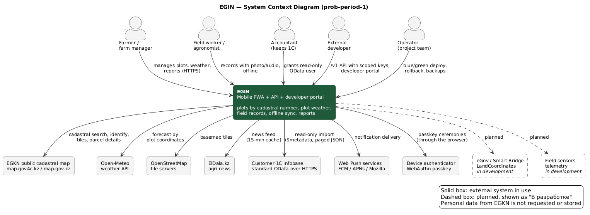
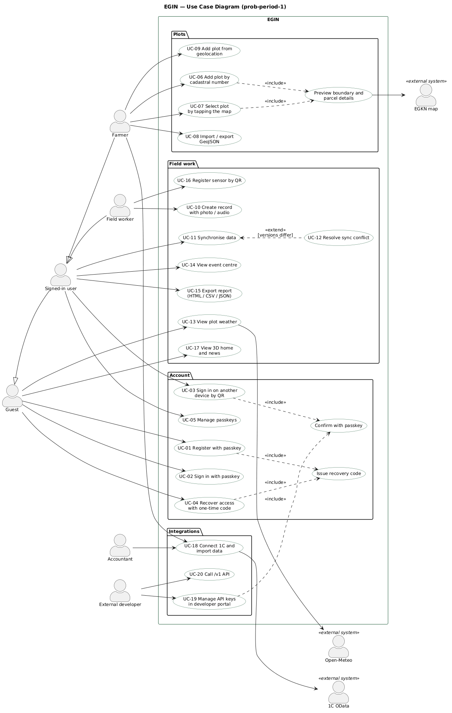
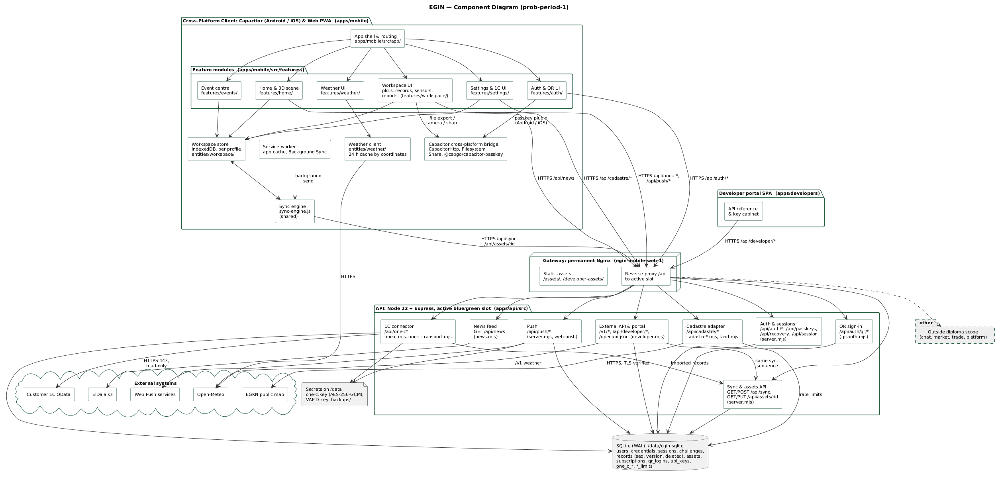
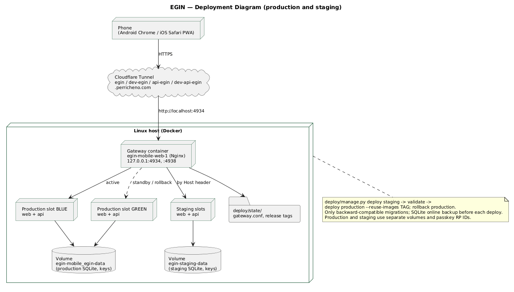
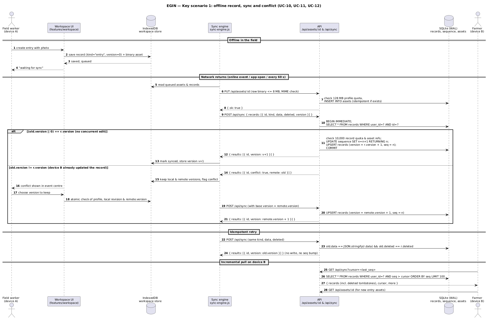
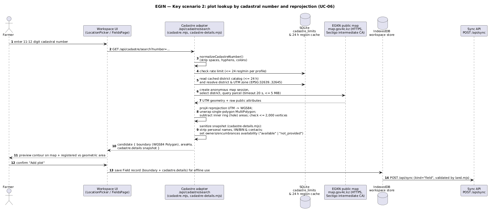

# 7. Architecture and Diagrams

The architecture diagrams have editable PlantUML sources in [`docs/DIP/diagrams/`](diagrams/) and readable exports (SVG and PNG) in [`docs/DIP/diagrams/export/`](diagrams/export/). To regenerate the SVG exports from the repository root, run `java -jar plantuml.jar -tsvg -o export docs/DIP/diagrams/*.puml`; repeat with `-tpng` for PNG. A public source file can also be POSTed to `https://kroki.io/plantuml/svg` or `https://kroki.io/plantuml/png`. The prototype navigation diagram has a separate [editable Mermaid source](diagrams/07-prototype-navigation.mmd), [SVG export](diagrams/export/07-prototype-navigation.svg) and [PNG export](diagrams/export/07-prototype-navigation.png).

**Evidence boundary.** These diagrams include intended native and manual-record flows. Capacitor support is configured, but an accepted native release is not established. Manual record creation remains partial because the current event-centre interface has no manual composer, as detailed in [Part 6](PART-6-REQUIREMENTS.md) and [Part 8](PART-8-UX-PROTOTYPE.md). Architecture diagrams describe structure and intended interactions; acceptance evidence and outstanding checks are recorded separately in [Part 9](PART-9-VERIFICATION-EVALUATION.md).

| # | Diagram | Source | Export |
|---|---|---|---|
| 7.2 | System context *(required)* | [PlantUML source](diagrams/01-system-context.puml) | [SVG](diagrams/export/01-system-context.svg) / [PNG](diagrams/export/01-system-context.png) |
| 7.3 | Use case *(required)* | [PlantUML source](diagrams/02-use-case.puml) | [SVG](diagrams/export/02-use-case.svg) / [PNG](diagrams/export/02-use-case.png) |
| 7.4 | Component diagram *(required)* | [PlantUML source](diagrams/03-component.puml) | [SVG](diagrams/export/03-component.svg) / [PNG](diagrams/export/03-component.png) |
| 7.5 | Deployment *(supplementary)* | [PlantUML source](diagrams/04-deployment.puml) | [SVG](diagrams/export/04-deployment.svg) / [PNG](diagrams/export/04-deployment.png) |
| 7.6 | Sequence 1: offline record, sync and conflict *(supplementary)* | [PlantUML source](diagrams/05-sequence-offline-sync.puml) | [SVG](diagrams/export/05-sequence-offline-sync.svg) / [PNG](diagrams/export/05-sequence-offline-sync.png) |
| 7.7 | Sequence 2: plot lookup by cadastral number *(supplementary)* | [PlantUML source](diagrams/06-sequence-cadastre-search.puml) | [SVG](diagrams/export/06-sequence-cadastre-search.svg) / [PNG](diagrams/export/06-sequence-cadastre-search.png) |

---

## 7.1 Architectural overview

EGIN is a **local-first, cross-platform client–server system**. The source of truth for the user's working copy is the phone (IndexedDB), and the server acts as a synchronisation and integration hub. This follows from the evidence in Section 2 and the literature in Section 3: rural connectivity is unstable [2], and the local-first approach keeps the application usable without a network [8].

The system has four deployable parts:

1. **Cross-platform client** (`apps/mobile`): a single React/TypeScript/Vite codebase delivered both as an installable **Web PWA** and as **Capacitor mobile applications for Android and iOS**. It contains the app shell, six feature packages (`home`, `weather`, `events`, `workspace`, `settings`, `auth`), the per-profile IndexedDB store, a single sync engine shared by the page and the service worker, a weather client with a cache keyed by coordinates, and the Capacitor bridge (`CapacitorHttp`, `Filesystem`, `Share`, `@capgo/capacitor-passkey`).
2. **Developer portal** (`apps/developers`): a separate SPA on `api-egin.perricheno.com`, with its own session cookie and QR audience.
3. **API** (`apps/api`): Node 22+ and Express, with `node:sqlite` (`DatabaseSync` in WAL mode) on a persistent volume. It is organised as installable modules: auth and sessions, QR sign-in, sync and binary assets, cadastre adapter, news, 1C connector, external API and portal, and push.
4. **Gateway**: a permanent Nginx container (`egin-mobile-web-1`) that serves hashed static assets (`/assets/`, `/developer-assets/`) and proxies `/api` to the active **blue/green** slot.

**Architectural style and the main decisions.** Section 5 compares alternatives for each of these decisions.

| Decision | Choice | Requirement driver |
|---|---|---|
| Client platform | Cross-platform Web & Mobile: Capacitor (Android & iOS) + PWA from one codebase (5.1) | NFR-CMP-1, NFR-USE-1, low entry barrier [1] |
| Data storage | IndexedDB on the device; SQLite WAL (`egin.sqlite`) on the server (5.2) | FR-SYNC-1, NFR-REL-3 |
| Synchronisation | Monotonic server sequence (`seq`), per-record `version`, tombstones (`deleted=1`), payload-equality idempotency and explicit conflict resolution, without CRDT (5.3) | FR-SYNC-3…5, NFR-REL-1, [8], [9] |
| Authentication | Passkeys (WebAuthn & `@capgo/capacitor-passkey` verified by `@simplewebauthn/server`) with a one-time recovery code; eGov pending (5.4) | FR-AUTH-1…5, [10], [11] |
| Cadastre source | Server-side adapter over the public EGKN map (`proj4` UTM → WGS84, PII stripping); GeoJSON and geolocation as fallbacks (5.5) | FR-FLD-1…5, NFR-SEC-7 |
| Weather source | Open-Meteo by plot coordinates (5.6) | FR-WTH-1…3 |
| Component interaction | REST/JSON over HTTPS through one gateway; there is no message broker | Simplicity of a single-node deployment, NFR-REL-2 |

---

## 7.2 System context diagram

**Description.** EGIN is used by five kinds of people: the farmer, the field worker, the accountant who keeps 1C, external developers and the operator. It depends on seven external systems. All outbound connections go through the **API**, except two: the weather forecast, which the client requests directly from Open-Meteo, and standard OpenStreetMap basemap tiles. This keeps credentials, rate limits and personal-data filtering on the server (NFR-SEC-4, NFR-SEC-5, NFR-SEC-7).

The dashed boxes, **eGov / Smart Bridge LandCoordinates** and **field sensor telemetry**, are deliberately outside the current boundary. They correspond to the *Won't* requirements FR-INT-3 and FR-SNS-3, and the UI shows them as "В разработке".

| External system | Interface | Used for | Requirements | Failure behaviour |
|---|---|---|---|---|
| EGKN public map | HTTPS, public map endpoints, TLS verified with Sectigo intermediate CA | Cadastral search, tap-to-identify, tiles, parcel details | FR-FLD-1…3 | Error message; GeoJSON and geolocation fallbacks (NFR-REL-4) |
| Open-Meteo | HTTPS REST | Forecast by coordinates | FR-WTH-1…3 | 24 h cached forecast labelled "stale" |
| OpenStreetMap, map.gov.kz aerial | HTTPS tiles (direct or proxied via `/api/cadastre/basemap/*`) | Basemap | FR-FLD-1 | Map without basemap; contours stay visible |
| ElDala.kz | HTTPS HTML feed | News | FR-HOME-4 | Last feed with `stale=true` |
| Customer 1C | OData over HTTPS/443, Basic Auth, read-only | Import of farm data | FR-INT-1…2 | Previously imported history is kept and marked |
| Web Push services | Web Push / VAPID (`fcm.googleapis.com`, `web.push.apple.com`, `updates.push.services.mozilla.com`) | Test notifications | FR-PUSH-1 | Nothing is lost; push is optional |
| Device authenticator | WebAuthn / Capacitor Passkey bridge through the browser or OS | Passkey registration and assertion | FR-AUTH-1…4 | Recovery code (FR-AUTH-2) |

---

## 7.3 Use case diagram

**Description.** The actors form a generalisation hierarchy: *Guest → Signed-in user → Farmer / Field worker*. A guest sees the 3D home screen, news and weather, and can register, sign in or recover access (FR-AUTH-6). The `<<include>>` relations show mandatory shared steps: issuing a recovery code, confirming with a passkey, and previewing a boundary before saving. `<<extend>>` shows that conflict resolution happens only when versions differ.

**Use case → requirement → component traceability.**

| Use case | Requirements | Main components (7.4) |
|---|---|---|
| UC-01 Register with passkey | FR-AUTH-1, FR-AUTH-2 | Auth & QR UI, Capacitor bridge, Auth & sessions |
| UC-02 Sign in with passkey | FR-AUTH-1 | Auth & QR UI, Capacitor bridge, Auth & sessions |
| UC-03 Sign in on another device by QR | FR-AUTH-4 | Auth & QR UI, QR sign-in, Auth & sessions |
| UC-04 Recover access | FR-AUTH-2 | Auth & QR UI, Auth & sessions |
| UC-05 Manage passkeys | FR-AUTH-3 | Settings & 1C UI, Auth & sessions |
| UC-06 Add plot by cadastral number | FR-FLD-1, FR-FLD-3, FR-FLD-7 | Workspace UI, Cadastre adapter, Workspace store |
| UC-07 Select plot on the map | FR-FLD-2, FR-FLD-3 | Workspace UI, Cadastre adapter |
| UC-08 Import / export GeoJSON | FR-FLD-4 | Workspace UI, Workspace store |
| UC-09 Add plot from geolocation | FR-FLD-5 | Workspace UI, Workspace store |
| UC-10 Create record with photo / audio | FR-REC-1, FR-SYNC-1 | Workspace UI, Capacitor bridge, Workspace store |
| UC-11 Synchronise data | FR-SYNC-2, 4, 5, 6, 7, 8 | Sync engine, Service worker, Sync & assets API |
| UC-12 Resolve sync conflict | FR-SYNC-3 | Event centre / Settings UI, Sync engine, Sync & assets API |
| UC-13 View plot weather | FR-WTH-1…3 | Weather UI, Weather client |
| UC-14 View event centre | FR-EVT-1 | Event centre UI, Workspace store |
| UC-15 Export report | FR-RPT-1 | Workspace UI, Capacitor bridge, Workspace store |
| UC-16 Register sensor by QR | FR-SNS-1, FR-SNS-2 | Workspace UI, Workspace store |
| UC-17 View 3D home and news | FR-HOME-1…4 | Home & 3D scene UI, News feed |
| UC-18 Connect 1C and import data | FR-INT-1, FR-INT-2 | Settings & 1C UI, 1C connector |
| UC-19 Manage API keys | FR-API-2 | Developer portal, External API & portal |
| UC-20 Call the /v1 API | FR-API-1, FR-API-3 | External API & portal, Sync & assets API |

The only functional requirement without a dedicated use case bubble is FR-PUSH-1 (Could); it is triggered from `Settings & 1C UI` (`POST /api/push/subscribe`, `POST /api/push/test`) and is omitted from the diagram to keep it readable.

---

## 7.4 Component diagram

**Description of components.** Each component maps to an exact path and route set verified in the repository.

| Component | Repository path | Responsibility | Exact HTTP / internal interfaces | Requirements |
|---|---|---|---|---|
| App shell & routing | `apps/mobile/src/app/` | Hash routing, bottom navigation, lazy screens with error recovery | — | NFR-USE-1, NFR-USE-2 |
| Home & 3D scene UI | `apps/mobile/src/features/home/` | 3D crop scene (pauses off-screen), plot summary, ElDala news cards | `GET /api/news` | FR-HOME-1…4, NFR-PERF-3 |
| Weather UI | `apps/mobile/src/features/weather/` | Hourly and 10-day forecast cards and charts | Uses Weather client | FR-WTH-1…3 |
| Event centre UI | `apps/mobile/src/features/events/` | Unified feed of weather state, boundary imports, sync conflicts, 1C runs and sensors | Reads Workspace store | FR-EVT-1 |
| Workspace UI | `apps/mobile/src/features/workspace/` | Plots (`FieldsPage`, `LocationPicker`, `FieldPreview`), records with media, QR sensor registry, HTML/CSV/JSON reports | `GET /api/cadastre/*`, reads/writes Workspace store | FR-FLD-1…7, FR-REC-1, FR-SNS-1…2, FR-RPT-1 |
| Settings & 1C UI | `apps/mobile/src/features/settings/` | Categories, passkey management, sync queue & conflict resolver, 1C connection, Web Push controls | `/api/one-c*`, `/api/passkeys*`, `/api/push/*` | FR-AUTH-3, FR-SYNC-3, FR-INT-1…2, FR-PUSH-1 |
| Auth & QR UI | `apps/mobile/src/features/auth/` | Passkey registration/sign-in, recovery code flow, cross-device QR scanner & confirmation | `/api/auth/*`, `/api/auth/qr/*` | FR-AUTH-1…5 |
| Workspace store | `apps/mobile/src/entities/workspace/` | Per-profile IndexedDB: records (`entry`, `field`, `sensor`, `profile`), queue, revisions, binary assets | Local API to UI & Sync engine | FR-SYNC-1, FR-SYNC-8 |
| Sync engine | `apps/mobile/src/entities/workspace/sync-engine.js` | Cursor pull, batch push, binary asset upload/download, version comparison, tombstones, conflicts. **One implementation** shared by the page and the service worker | `GET /api/sync?cursor=`, `POST /api/sync`, `GET/PUT /api/assets/:id` | FR-SYNC-2…7, NFR-MNT-2 |
| Service worker | `apps/mobile/scripts/` (build) | Offline app shell, Background Sync, update prompt; sensitive API responses are not cached | Invokes `sync-engine.js` | NFR-PERF-2, NFR-CMP-2 |
| Weather client | `apps/mobile/src/entities/weather/` | Open-Meteo requests, normalisation, 24 h cache by coordinates | HTTPS to `api.open-meteo.com` | FR-WTH-1…3 |
| Capacitor cross-platform bridge | `apps/mobile/scripts/prepare-native.mjs`, `native-trust.mjs` | Cross-platform Android & iOS packaging of local `dist`; bridges `CapacitorHttp`, `Filesystem`, `Share`, `@capgo/capacitor-passkey`, camera, microphone and geolocation | Capacitor JS-to-OS plugin bridge | FR-AUTH-1, FR-RPT-1, NFR-CMP-1, NFR-MNT-3 |
| Developer portal | `apps/developers/` | API reference rendered from `catalog.json`, key cabinet | `/api/developer/*`, `/openapi.json` | FR-API-2, FR-API-3 |
| Gateway | `deploy/nginx.conf`, `deploy/manage.py` | Serves `/assets/` and `/developer-assets/`, proxies `/api` to active blue/green slot, runs health checks and rollback | HTTP `127.0.0.1:4934` / `:4938` | NFR-REL-2 |
| Auth & sessions | `apps/api/src/server.mjs` (`@simplewebauthn/server`) | Passkey registration and assertion (Web & Capacitor origins), recovery code rotation, 30-day sessions | `GET /api/session`, `POST /api/auth/register/{options,verify}`, `POST /api/auth/login/{options,verify}`, `POST /api/auth/recover`, `POST /api/logout`, `GET /api/passkeys`, `DELETE /api/passkeys/:id`, `POST /api/recovery` | FR-AUTH-1…3, NFR-SEC-1 |
| QR sign-in | `apps/api/src/qr-auth.mjs` | Two-minute QR requests bound to browser cookie; single-use session issue | `POST /api/auth/qr`, `GET/POST /api/auth/qr/:id`, `POST /api/auth/qr/:id/reject`, `POST /api/developer/qr` | FR-AUTH-4 |
| Sync & assets API | `apps/api/src/server.mjs` | Owner checks, `BEGIN IMMEDIATE` version comparison, monotonic `sequence`, tombstones, payload-equality idempotency, binary assets, quotas (10,000 records, 128 MB per profile, 8 MB per asset) | `GET /api/sync`, `POST /api/sync`, `PUT /api/assets/:id`, `GET /api/assets/:id` | FR-SYNC-3…5, NFR-SEC-2, NFR-CAP-1 |
| Cadastre adapter | `cadastre.mjs`, `cadastre-tiles.mjs`, `cadastre-raster.mjs`, `cadastre-details.mjs`, `land.mjs` | Search and tap-identify, UTM → WGS84 with `proj4`, tile reprojection, detail snapshot without personal data, rate limits | `GET /api/cadastre/{search,identify,labels,regions,district}`, `GET /api/cadastre/tiles/:z/:x/:y.png`, `GET /api/cadastre/basemap/:z/:x/:y.png` | FR-FLD-1…3, NFR-PERF-4, NFR-SEC-7 |
| News feed | `apps/api/src/news.mjs` | ElDala parsing, 15-minute file cache (`/data/news-cache.json`), stale fallback | `GET /api/news` | FR-HOME-4 |
| 1C connector | `one-c.mjs`, `one-c-transport.mjs` | Encrypted credentials (AES-256-GCM with `/data/one-c.key`), OData XML `$metadata`, paged read-only import, SSRF protection | `/api/one-c*` | FR-INT-1…2, NFR-SEC-3, NFR-SEC-5 |
| External API & portal | `developer.mjs`, `catalog.json` | `/v1` CRUD through the same sync sequence, SHA-256 hashed scoped keys, 60 req/min rate limit, `If-Match`, OpenAPI | `/v1/*`, `/api/developer/*`, `GET /openapi.json` | FR-API-1…3, NFR-SEC-4 |
| Push | `apps/api/src/server.mjs` (`web-push`) | VAPID public key, device subscriptions (≤ 20 per user, allowlisted push domains), test delivery | `GET /api/push/key`, `POST /api/push/{subscribe,unsubscribe,test}` | FR-PUSH-1 |
| SQLite (WAL) | `/data/egin.sqlite` | Persistent relational & document store shared by active/standby slots of one environment | `node:sqlite` (`DatabaseSync`) | NFR-REL-3, NFR-REL-5 |

**Important internal dependency.** Both the `/v1` API (`developer.mjs`) and the 1C import (`one-c.mjs`) write through the **same `records` and `sequence` tables** as `/api/sync`. Records created or updated by external systems therefore receive monotonic `seq` cursors and `version` increments identically to mobile client records (FR-INT-2, FR-API-1).

**Outside the diploma scope.** The repository also contains chat, market, trade and business-platform modules (`apps/api/src/{chat,market,trade,platform}`). They are shown as a single dashed package on the diagram and are outside the scope defined in Section 1.6 and Section 6.

### 7.4.1 Physical & logical data model (verified against `apps/api/src/*.mjs`)

All core tables reside in `/data/egin.sqlite` (SQLite WAL mode). Application entities (`field`, `entry`, `sensor`, `profile`) are stored in a unified versioned `records` table on the server and mirrored in per-profile IndexedDB stores on the client.

| SQLite table / file | Primary key & main columns | Purpose & constraints |
|---|---|---|
| `users` | `id TEXT PK`, `name TEXT NOT NULL`, `recovery TEXT`, `created INTEGER` | User profile and SHA-256 hash of the current one-time recovery code |
| `credentials` | `id TEXT PK`, `user_id FK`, `public_key BLOB`, `counter INTEGER`, `transports TEXT`, `name TEXT`, `created INTEGER` | Registered WebAuthn / Capacitor passkeys (`ON DELETE CASCADE`) |
| `challenges` | `id TEXT PK`, `type TEXT`, `challenge TEXT`, `user_id TEXT`, `name TEXT`, `expires INTEGER` | Short-lived WebAuthn registration and authentication challenges |
| `sessions` | `id TEXT PK`, `user_id FK`, `expires INTEGER` | 30-day main-app sessions (`HttpOnly`, `Secure`, `SameSite=Lax`) |
| `qr_logins` | `id TEXT PK`, browser binding hash, `user_id`, `expires`, status | 2-minute cross-device QR login ceremonies (`qr-auth.mjs`) |
| `records` | `PRIMARY KEY (user_id, id)`, `kind TEXT` (`'entry' \| 'field' \| 'sensor' \| 'profile'`), `data TEXT` (JSON), `deleted INTEGER` (0/1 tombstone), `version INTEGER`, `seq INTEGER` | Unified versioned store for plots (including `boundary` and `cadastre.details`), journal entries, sensor registry and profile settings; capped at 10,000 rows per `user_id` |
| `sequence` | `n INTEGER` (single-row counter) | Monotonic change cursor (`UPDATE sequence SET n=n+1 RETURNING n`) used by `GET /api/sync?cursor=` |
| `assets` | `PRIMARY KEY (user_id, id)`, `mime TEXT`, `data BLOB` | Binary photos (`image/jpeg\|png\|webp`) and audio (`audio/webm\|ogg\|mp4\|mpeg\|wav`); ≤ 8 MB per row, ≤ 128 MB total per `user_id` |
| `subscriptions` | `PRIMARY KEY (user_id, endpoint)`, `data TEXT` | Web Push subscriptions (≤ 20 per user; allowlisted FCM / Apple / Mozilla HTTPS endpoints) |
| `api_keys`, `api_limits`, `api_usage`, `developer_sessions` | Key id, `open_key`, SHA-256 `secret_hash`, scopes, expiry, per-minute counters, sanitised audit log | External `/v1` API authentication, 60 req/min rate limiting, 12-hour portal sessions (`developer.mjs`) |
| `one_c_connections`, `one_c_sources`, `one_c_runs`, `one_c_revisions`, `one_c_previews`, `one_c_limits` | Owner-scoped OData URL, encrypted password ciphertext, deterministic source mappings, lease locks | Read-only 1C OData import, idempotent re-sync, 12 req/min rate limit (`one-c.mjs`) |
| `cadastre_limits`, `cadastre_tile_limits`, `cadastre_view_limits` | Per-user / per-window counters | Rate limiting across blue/green slots: 24/min search, 60/min metadata, 240/min tiles |
| `/data/one-c.key`, VAPID key, `/data/backups/` | Files on persistent volume (`0600`) | AES-256-GCM master key for 1C passwords, Web Push VAPID key, online SQLite backups |

---

## 7.5 Deployment diagram (supplementary)

Requests from the phone pass through Cloudflare Tunnel to a single **permanent gateway** (`egin-mobile-web-1`). The gateway proxies to the active production slot (blue or green). The other slot stays available for an immediate rollback. Staging runs on the same host with **separate data volumes (`egin-staging-data`) and passkey RP IDs** (NFR-SEC-6).

Release workflow:

1. `python3 deploy/manage.py deploy staging`
2. Validation on `dev-egin.perricheno.com` and `dev-api-egin.perricheno.com`
3. `python3 deploy/manage.py deploy production --reuse-images TAG`, which promotes the exact container images verified on staging

Before each deploy, an online SQLite backup and a copy of `one-c.key` are written to `/data/backups/` (NFR-REL-3). Database migrations must be backward-compatible, because both production slots share one volume (NFR-REL-5).

---

## 7.6 Key scenario 1: offline record, sync and conflict (supplementary)

This sequence diagram traces UC-10, UC-11 and UC-12 across the exact endpoints and SQLite statements in `server.mjs`:

1. **Offline write:** `Workspace UI` saves the record (`kind="entry"`, `version=0`) and its photo in `IndexedDB`.
2. **Binary upload first:** when connectivity returns, `sync-engine.js` uploads each binary attachment via `PUT /api/assets/:id` (checked for MIME type, ≤ 8 MB size and the 128 MB profile quota; idempotent if the asset ID already exists).
3. **Transactional batch sync:** `POST /api/sync` runs inside `BEGIN IMMEDIATE`, verifies that all referenced asset IDs exist in `assets`, checks the 10,000-record quota, compares `(old?.version || 0)` with `r.version`, increments the global `sequence` cursor (`seq`), and upserts `records` with `version = r.version + 1`.
4. **Explicit conflict:** if `old.version !== r.version`, the server does not overwrite the row; it returns `{ id, conflict: true, remote: old }`. After the user picks a version, the client resends the record with `version = remote.version`.
5. **Idempotent retry:** if a retried request sends a record whose `kind`, `data` and `deleted` flag already match the stored row, the server returns the existing `version` without writing or advancing `seq`.
6. **Incremental pull:** Device B calls `GET /api/sync?cursor=<last_seq>` (`SELECT * FROM records WHERE user_id=? AND seq>? ORDER BY seq LIMIT 100`), receiving updated records and tombstones (`deleted=true`), and then fetches any new attachments via `GET /api/assets/:id`.

---

## 7.7 Key scenario 2: plot lookup by cadastral number and reprojection (supplementary)

This sequence diagram traces UC-06 across `LocationPicker.tsx`, `cadastre.mjs`, `cadastre-details.mjs` and `land.mjs` (FR-FLD-1, FR-FLD-3, FR-FLD-7, NFR-PERF-4, NFR-SEC-7):

1. The farmer enters an 11–12-digit cadastral number; `GET /api/cadastre/search?number=...` normalises separators and checks the 24 req/min profile limit in `cadastre_limits`.
2. Using the 24-hour cached district catalog, the adapter determines the district and its local UTM zone (`EPSG:32639`–`32645`) and queries `map.gov4c.kz` over verified HTTPS (using the bundled Sectigo intermediate CA, ≤ 20 s timeout, ≤ 5 MiB response).
3. The adapter reprojects the geometry from UTM to WGS84 with `proj4`, normalises single-polygon `MultiPolygon` geometries, subtracts inner hole areas, and verifies the ≤ 2,000-vertex limit.
4. `cadastre-details.mjs` builds a sanitised public snapshot (`Field.cadastre.details`), stripping all personal names, individual IINs, contacts and operator metadata, and distinguishing `"available"` from `"not_provided"`.
5. The UI previews the contour and displays both geometric and registered areas before saving. Once confirmed, the plot is written to `IndexedDB` for offline use and synchronised via `POST /api/sync` (`kind="field"`).

---

## 7.8 Consistency check: requirements, components, data and scenarios

| Check | Result |
|---|---|
| Every **Must** FR is realised by at least one use case | **Yes** — mapped in the 7.3 traceability table (UC-01…UC-20) |
| Every use case is served by specific UI, cross-platform bridge and server components | **Yes** — decomposed into 6 feature packages (`home`, `weather`, `events`, `workspace`, `settings`, `auth`), the Capacitor bridge, and 8 API modules in 7.4 |
| Every component maps to an exact repository path and verified HTTP routes | **Yes** — all routes (`/api/auth/*`, `/api/auth/qr/*`, `/api/sync`, `/api/assets/:id`, `/api/cadastre/*`, `/api/one-c*`, `/api/push/*`, `/v1/*`) verified against `apps/api/src/*.mjs` |
| Data model matches physical SQLite tables and record kinds | **Yes** — all tables in 7.4.1 (`users`, `credentials`, `sessions`, `challenges`, `qr_logins`, `records`, `sequence`, `assets`, `subscriptions`, `api_keys`, `one_c_*`, `*_limits`) match `CREATE TABLE` definitions in `apps/api/src/` |
| Key engineering scenarios are traced end-to-end | **Yes** — Sequence 1 (7.6) covers offline writes, binary assets, `seq`/`version` sync, conflicts and idempotency; Sequence 2 (7.7) covers cadastral search, UTM→WGS84 reprojection and PII filtering |
| Every external system in 7.2 appears as a dependency in 7.4 | **Yes** — EGKN, Open-Meteo, OSM/basemap, ElDala, 1C OData, Web Push and WebAuthn / Capacitor Passkey authenticator |
| Every *Won't* item is outside the system boundary | **Yes** — eGov, LandCoordinates and sensor telemetry are dashed in 7.2 and excluded from 7.3 and 7.4 |
