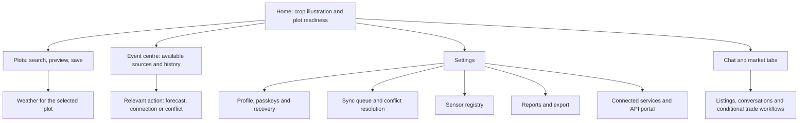
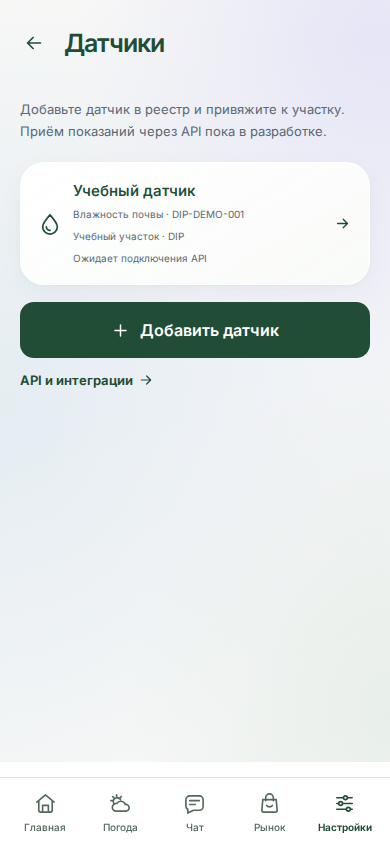

# 8. UX and Prototype

## 8.1 Purpose and evidence boundary

The EGIN prototype demonstrates how a farmer can move from a mobile home screen to a plot, its forecast, available events, sensor registration and data export. A separate developer portal demonstrates how an external system can discover the API and obtain scoped access. These interfaces provide concrete interaction evidence for the criterion: *“Mockups of key user scenarios; for projects without a user interface, examples of APIs, commands, or input and output data.”*

This section is based on the source at commit `8cc0ca3f73052b030dcddb990b8a5460be9ddcdf`, inspected on **23 October 2026**, and on the actual interface captures in [Section 8.5](#85-captured-interface-evidence). The source audit and screenshot capture are different kinds of evidence:

| Evidence level | Meaning in this section | Limitation |
|---|---|---|
| **Observed interface** | A real locally served web bundle rendered the screen, and the capture script checked the stated elements. | API responses and local records were fixtures; this is not a live-service acceptance test. |
| **Implemented in source** | Components, routes and associated API or test code exist in the inspected repository. | Presence of code does not establish that every interaction passes on the deployed service. |
| **Partial** | Some supporting functions exist, but a stated end-user scenario or external integration is incomplete. | The missing step must be disclosed during the defence. |
| **Pending / outside this stage** | The interface explicitly marks the function as unavailable, or its implementation is outside the approved scope. | It must not be demonstrated as a working integration. |

**Build provenance.** Both web applications were freshly built from commit [`b0b0f46`](https://github.com/Adilzhan17/egin/commit/b0b0f46fc4c4c89422066317c4d550fc0bc25162) in an isolated temporary directory, and the nine screenshots were recaptured at **2026-10-23T17:12:27.705Z**. Its `apps` tree and the historical `8cc0ca3` review tree are identical (`3c5eda79a3be6e2c00533ce5da288c5446987f92`). The earlier missing optional Rolldown binding was resolved in the isolated dependency copy; shared dependencies were not modified. TypeScript checking and Vite builds passed for both web apps, and the mobile service worker was generated. The [capture metadata](evidence/ux/capture-metadata.json), [complete artifact fingerprints](evidence/ux/build-artifacts.json) and [web-build execution record](evidence/verification/2026-10-23-web-build-capture.txt) identify the source, environment and output. This establishes source-to-screenshot traceability while preserving the fixture limitations below; broader verification results remain separate in [Part 9](PART-9-VERIFICATION-EVALUATION.md).

---

## 8.2 Interaction principles and navigation

The main application follows a phone-first layout with a prominent crop illustration, dark green controls, a light background and bottom navigation. The five main tabs are **Home, Weather, Chat, Market and Settings**. Plot management and the event centre are reached from the home screen or Settings. The active bottom-navigation item changes its icon and text colour without a filled tab background. Safe-area spacing, semantic controls, a skip link and reduced-motion handling are present in the source; this inspection is not a completed accessibility audit.

The interface currently uses Russian. English names in this report describe the actual Russian controls; the screenshots retain the original UI text. Hash routes, such as `/#/fields`, are used by the application. The canonical route inventory is in [App.tsx](../../apps/mobile/src/app/App.tsx); settings subsections are selected in [SettingsPage.tsx](../../apps/mobile/src/features/settings/SettingsPage.tsx).



The visualisation is deliberately separated from agronomic measurement. [HomePage.tsx](../../apps/mobile/src/features/home/HomePage.tsx) and [monitoring.ts](../../apps/mobile/src/entities/field/monitoring.ts) label the crop as an illustration while monitoring data is unavailable. A visual weather preview does not constitute a crop prediction. Local and staging hosts also expose an experimental 2D/3D switch; the capture script selected 3D. This laboratory control should not be represented as a production-wide feature.

---

## 8.3 Screen inventory and implementation status

Requirement IDs refer to [Part 6](PART-6-REQUIREMENTS.md). “Observed” applies only to the screen state captured in this review. Existing automated scenarios are linked as evidence of available coverage, not as a claim that those suites were all executed successfully during this audit.

| Screen / entry point | Main interaction and output | Current evidence and limits | Requirements / source |
|---|---|---|---|
| Home, `/#/` | Inspect the crop illustration, change its viewpoint, read plot readiness and open the next action. | **Observed interface; implemented in source.** No measured plant state or digital twin is demonstrated. | FR-HOME-1–4; [HomePage](../../apps/mobile/src/features/home/HomePage.tsx), [FieldReadiness](../../apps/mobile/src/features/home/FieldReadiness.tsx) |
| Plots, `/#/fields` | Search by cadastral number, select on the map or import GeoJSON; inspect the boundary before confirming; inspect/export a saved plot. | **Observed saved demo plot; acquisition implemented in source.** A synthetic boundary is clearly labelled; live EGKN search was not executed in the capture. Local guest storage is available; server synchronisation requires sign-in. | FR-FLD-1–7; [FieldsPage](../../apps/mobile/src/features/workspace/FieldsPage.tsx), [ParcelPassport](../../apps/mobile/src/features/workspace/ParcelPassport.tsx) |
| Weather, `/#/weather` | Read current, hourly and ten-day forecasts, change the displayed metric and inspect details. | **Observed fixture forecast; implemented in source.** Forecast values are model output, not on-site sensor readings. The screenshot contains the repository fixture's historical forecast date. | FR-WTH-1–3; [WeatherPage](../../apps/mobile/src/features/weather/WeatherPage.tsx) |
| Events, `/#/events`; legacy `/#/journal` | Filter available events by source, plot, importance and text; follow an action; read preserved history and attachments. | **Observed interface; partial relative to manual record creation.** Both routes open the event centre. There is no current manual record composer. | FR-EVT-1; FR-REC-1 remains partial; [EventsPage](../../apps/mobile/src/features/events/EventsPage.tsx) |
| Sign-in, `/#/auth`; security, `/#/settings/security` | Register/sign in with a passkey, use recovery, manage additional keys, approve another device's QR login. | **Observed sign-in screen; web authentication flows implemented in source.** Native iOS passkey configuration remains pending (FR-AUTH-1 is partial). No real or virtual passkey ceremony was performed by the screenshot script. eGov remains unavailable. | FR-AUTH-1–5; [AuthPage](../../apps/mobile/src/features/auth/AuthPage.tsx), [ProfilePage](../../apps/mobile/src/features/settings/ProfilePage.tsx) |
| Synchronisation, `/#/settings/sync` | Inspect pending records and conflicts, trigger synchronisation and choose a conflict resolution. | **Implemented in source; not captured end to end.** Local writes and server synchronisation are separate states. Direct fixture insertion of a history entry does not demonstrate a user-facing entry editor. | FR-SYNC-1–8; [SyncPage](../../apps/mobile/src/features/settings/SyncPage.tsx), [workspace browser scenario](../../apps/mobile/tests/workspace.cjs) |
| Sensors, `/#/settings/sensors` | Register a sensor by QR/manual ID and link it to a plot. | **Observed registry state; registration implemented in source.** The UI states that receiving readings is still in development. | FR-SNS-1–3; [SensorsPage](../../apps/mobile/src/features/workspace/SensorsPage.tsx) |
| Reports, `/#/settings/reports` | Select plot, period, format and optional preserved history/media; generate an export and download/share it. | **Observed controls; generation implemented in source.** Formats include HTML, plot CSV, history CSV and JSON. No export download was executed by the capture script. | FR-RPT-1; [ReportsPage](../../apps/mobile/src/features/workspace/ReportsPage.tsx), [report-export](../../apps/mobile/src/features/workspace/report-export.ts) |
| Connected services, `/#/settings/services` | Configure read-only 1C import, map fields, preview changes and review exchange history; prepare other connection requests. | **1C workflow implemented in source; partner integrations partial.** AgroSignal and AgroStream pages collect preparation details; their data exchange is not operational. | FR-INT-1–3; [OneCPage](../../apps/mobile/src/features/settings/OneCPage.tsx), [ServicesPage](../../apps/mobile/src/features/settings/ServicesPage.tsx) |
| Chat, `/#/chat` | Open conversations/communities and exchange supported messages and attachments. | **Implemented in source; authenticated interaction not captured.** This is an actual feature, not the former development placeholder. | Extension not yet assigned a Part 6 requirement ID; [ChatPage](../../apps/mobile/src/features/chat/ChatPage.tsx), [chat browser scenario](../../apps/mobile/tests/chat.cjs) |
| Market, `/#/market` | Search/filter listings, view details, save favourites and create a listing after sign-in. | **Observed empty catalogue; other workflows implemented in source.** The empty screenshot is a chosen fixture, not evidence of the number of real users or listings. | Extension not yet assigned a Part 6 requirement ID; [MarketPage](../../apps/mobile/src/features/market/MarketPage.tsx), [PublicationWizard](../../apps/mobile/src/features/market/PublicationWizard.tsx) |
| Trade and organisation cabinet, `/#/market?view=trade` and `?view=business` | Manage harvest lots, offers, deals, documents and organisation/team details. | **Implemented in source, with conditional availability.** Organisation roles and feature flags control access; private demo data must be distinguished from real transactions. These workflows were not executed for the captures. | Extension not yet assigned a Part 6 requirement ID; [TradePage](../../apps/mobile/src/features/trade/TradePage.tsx), [BusinessPanel](../../apps/mobile/src/features/business/BusinessPanel.tsx) |
| Developer portal, separate web application | Browse API methods, request/response examples, scope requirements and key management. | **Observed public documentation; key lifecycle implemented in source.** Separate QR audience/session and main-app passkey approval apply. No secrets were issued during this review. | FR-API-1–3; [portal App](../../apps/developers/src/App.tsx), [Cabinet](../../apps/developers/src/Cabinet.tsx) |

---

## 8.4 Key user flows

### 8.4.1 Establish a plot and inspect its forecast

**Actor:** farmer. **Goal:** reach plot-specific information without manually redrawing an existing cadastral boundary.

1. Open Home and follow the plot-readiness action to Plots.
2. Choose cadastral search, map selection or GeoJSON import. A point without boundaries is a fallback where appropriate.
3. Review the candidate boundary and available public details. An unsuccessful search must produce an actionable error; it must not silently create an empty plot.
4. Confirm the plot and select it as active. The local record becomes the context for the home summary, forecast and linked sensor registry.
5. Open Weather and inspect the selected plot name, source timestamp and relevant hourly/daily values.

**Visible completion:** the selected plot is present, its geometry or absence of boundaries is explicit, and the forecast names that plot. A cadastral snapshot does not prove ownership. Cached or unavailable data must not be presented as a fresh measurement. The corresponding source scenarios are [map-picker.cjs](../../apps/mobile/tests/map-picker.cjs), [parcel-passport.cjs](../../apps/mobile/tests/parcel-passport.cjs) and [home-weather.cjs](../../apps/mobile/tests/home-weather.cjs).

### 8.4.2 Preserve local work and resolve a synchronisation conflict

**Actor:** farmer or field worker. **Goal:** keep locally supported changes available and reconcile differences between devices.

1. Create or edit a supported local object, such as a plot or sensor registry entry.
2. Inspect the synchronisation screen and distinguish local/pending state from confirmed server synchronisation.
3. Sign in and reconnect to synchronise the profile. If the server has a concurrent version, inspect the conflict rather than assuming an overwrite occurred.
4. Choose the appropriate version and synchronise again.

**Visible completion:** the pending state or conflict is resolved and the selected data is retained. A two-device demonstration requires a disposable authenticated profile and a separate test run. The existing [workspace scenario](../../apps/mobile/tests/workspace.cjs) seeds history entries directly into IndexedDB to test preservation and conflicts. This is useful storage/synchronisation evidence, but it does not prove that a user can create or edit such entries through the present UI. The screenshot capture does not test service-worker offline reload.

### 8.4.3 Review events and export available information

**Actor:** farmer. **Goal:** understand available plot information and prepare a shareable file.

1. Open the event centre from the home readiness card or Settings.
2. Filter by plot, source or importance, or search the event text.
3. Open the relevant forecast, connection or conflict screen, or inspect preserved history/materials.
4. Open Reports, select a plot and format, and optionally include available history and media.
5. Generate the report and download or share the result through supported browser controls.

**Visible completion:** the report represents the selected local data and period, and a file is produced. The report period applies to history; plot passports contain the latest saved details. Missing sources are disclosed. The event feed is not a continuous server archive of every weather change, and absence of events does not establish normal field conditions.

### 8.4.4 Register a sensor without implying telemetry

**Actor:** farmer. **Goal:** associate a physical device identifier with a plot for future integration.

1. Open Settings → Sensors → Add sensor.
2. Scan a supported EGIN sensor QR code, load its image, or enter the identifier manually.
3. Review the identifier, name, type and associated plot, then save.
4. Confirm that the item appears in the registry with the pending API-connection status.

**Visible completion:** a registry entry exists. This flow does not show live moisture, connectivity, agronomic alerts or an automatic crop phase. The distinction is visible in [Figure 8.5](evidence/ux/05-sensors.png) and enforced by the explicit `FR-SNS-2` requirement.

### 8.4.5 Sign in and grant external API access

**Actors:** account owner and external developer. **Goal:** provide controlled access to the owner's EGIN data.

1. Sign in to the main application with a passkey, retaining the recovery code securely when it is issued.
2. Open the separate developer portal and start its QR sign-in flow.
3. Confirm the correct destination and matching code in the main application, and approve with a fresh passkey assertion.
4. Select the required scopes and expiry when issuing a key pair.
5. Copy the secret at issuance, use it from the integrating server, and rotate/revoke it when required.

**Visible completion:** the developer session can manage scoped keys and an authorised request returns the owner's permitted data. Portal and main-app sessions are separate. Plaintext secrets are displayed only at issuance/rotation and must be excluded from screenshots. eGov is not involved in this process. The full flow requires a dedicated acceptance run; the present evidence shows the sign-in screen and public API reference only.

### 8.4.6 Explore communication and marketplace extensions

**Actor:** authenticated farmer or organisation member. **Goal:** communicate and find or publish agricultural offers.

The actual Chat tab leads to conversations and communities. The actual Market tab supports catalogue search, filters, listing detail, favourites and a publication wizard. Organisation trade screens provide additional lot, offer and deal interactions when the relevant feature flags and permissions are enabled. These extensions should be demonstrated separately from the core plot/weather scenario, with synthetic accounts and listings. Their source presence is verified; a successful complete commercial workflow or adoption by real farms is not established here. Dedicated requirement IDs and outcome measures remain to be reconciled with Parts 6 and 9 before these extensions are used to claim the diploma's aim has been achieved.

---

## 8.5 Captured interface evidence

Nine screenshots were captured on **23 October 2026** in Chromium **153.0.8010.12**, using a **390 × 844 CSS px** mobile viewport and **1280 × 900 CSS px** for the developer portal. Device scale factor was 1; reduced motion was requested. These are screenshots of the application's actual rendered interface, not generated mockups.

All API responses were intercepted locally. Weather and news came from the repository's existing fixtures. A clearly labelled synthetic plot, sensor and historical entry were inserted only into the temporary browser profile's IndexedDB. The map basemap was intentionally unavailable, which exposes the real fallback message while the local boundary remains visible. No production data, real farmer record, passkey credential or API secret was used. The Russian text inside the images is the original interface, while captions and analysis are in English.

| Figure | Screenshot | Demonstrated interaction/state | Evidence limitation |
|---|---|---|---|
| 8.1 | [Home and 3D crop illustration](evidence/ux/01-home.png) | First-use home, model controls and the invitation to add a plot. | Weather/news fixtures; local laboratory switch visible; no measured crop state. |
| 8.2 | [Saved plot and boundary](evidence/ux/02-fields.png) | Synthetic contour, demo label, plot details and GeoJSON export control. | Full-page capture; basemap disabled; not an EGKN response or land-rights record. |
| 8.3 | [Plot-specific weather screen](evidence/ux/03-weather.png) | Plot name, forecast timestamp, hourly graph and daily-tab entry. | Historical fixture data dated 8 October; not a forecast retrieved on the capture date. |
| 8.4 | [Event centre](evidence/ux/04-events.png) | Source/plot filters, demo-plot event, sensor registration and preserved history. | Full-page capture; generated from synthetic local records. |
| 8.5 | [Sensor registry](evidence/ux/05-sensors.png) | Plot-linked sensor and explicit pending API-connection state. | Registration record only; no telemetry or field measurement. |
| 8.6 | [Report controls](evidence/ux/06-reports.png) | Plot/format/period selection and optional history/media. | Full-page capture; generation/download was not executed by this script. |
| 8.7 | [Sign-in and pending eGov option](evidence/ux/07-auth.png) | Passkey, recovery and EGIN QR entry points; unavailable eGov. | Full-page capture; no successful authentication claim. |
| 8.8 | [Marketplace catalogue](evidence/ux/08-market.png) | Search, categories, filters, publication entry and empty-state guidance. | Deliberately empty fixture catalogue; no live inventory or trade transaction. |
| 8.9 | [Developer API reference](evidence/ux/09-developer-portal.png) | Separate interface for method discovery and API usage. | Public documentation only; key issuance and live requests not executed. |

**Figure 8.1 — actual mobile home screen, isolated fixture environment.**


**Figure 8.5 — actual sensor-registry screen with pending telemetry status.**



The [capture script](evidence/ux/capture.cjs) checked real screen rendering, 3D canvas readiness, 24 hourly forecast entries, the absence of a manual event composer, the pending sensor-connection message and the empty catalogue state. The final capture completed with **zero browser page errors**. [Reproduction instructions](evidence/ux/README.md) and [machine-readable metadata](evidence/ux/capture-metadata.json) describe the environment. This small capture check is not a replacement for authenticated browser tests, offline/PWA checks, live integration validation or a user study.

---

## 8.6 External-system interaction example

The developer portal supplements the visual prototype with inspectable request/response contracts generated from [catalog.json](../../apps/api/src/catalog.json). For example, the `fields-list` operation uses `GET /v1/fields`, requires the `fields:read` scope and returns a paginated collection of the profile's plots. The following is an **illustrative request**, not a request executed during this review:

```http
GET /v1/fields?limit=20 HTTP/1.1
Host: dev-api-egin.perricheno.com
X-EGIN-Key: <issued-open-key>
Authorization: Bearer <issued-secret-key>
```

The documented successful response envelope contains `success`, `result`, `next_cursor` and `request_id`; plot records include a version. Invalid or expired credentials, insufficient scopes and stale update versions are separate rejection cases. The exact methods, parameters and examples are browsable in the portal. For a defence demonstration, use a disposable staging account, show a permitted read followed by a rejected request with insufficient scope, and redact secrets from every capture. This demonstration remains to be executed under the conditions in [Part 9](PART-9-VERIFICATION-EVALUATION.md).

---

## 8.7 Remaining work for the UX criterion

| Item | Current position | Required next evidence |
|---|---|---|
| Key screen and navigation coverage | Actual UI screenshots, route inventory and source-backed flows are provided in this section. | Include the relevant figures in the defence slides and walk through one coherent scenario. |
| Screenshot-to-commit traceability | Completed for these captures: fresh web builds from `b0b0f46`, identical application tree to `8cc0ca3`, recorded commands and artifact hashes. | Preserve the build manifest with the submission; rebuild and recapture if the application source changes. |
| Complete core scenario | Plot/weather/event/report screens exist; the capture shows selected states only. | Record a disposable-account walkthrough: sign-in, plot acquisition, forecast, supported offline edit, synchronisation and export; retain the execution log. |
| Manual history-entry workflow | Preserved history and attachments remain readable; storage/API support exists. | Resolve the scope of FR-REC-1 and FR-SYNC-1 with the supervisor: implement/restore a composer if required, or explicitly document the reduced UI scope. Do not present seeded records as user-entered records. |
| Cross-device and accessibility evidence | Responsive styles and browser scenarios exist. | Run the relevant current-commit scenarios and carry out real-device, keyboard, contrast and touch-target checks; retain results. |
| User validation | No observed usability study is attached to this section. | Run the proposed tasks with representative users and record completion, errors and time as planned in Part 9. Interest in the idea is not usability-test evidence. |
| Extended chat/market/trade scope | Current source includes these functions beyond the earlier core specification. | Approve their requirement mapping, choose representative permitted workflows and record results separately. |
| External integrations and native packages | eGov, sensor telemetry and partner exchanges remain pending; native delivery is outside this review. | Keep these limits visible. Build Android/iOS packages only after the owner's explicit release request; browser/PWA evidence must not be described as an APK/IPA test. |

The provided material makes the intended interaction visible and traceable. Successful operation of every end-to-end scenario, measurable usability improvement and deployed/native compatibility remain separate claims requiring the additional evidence specified above.
