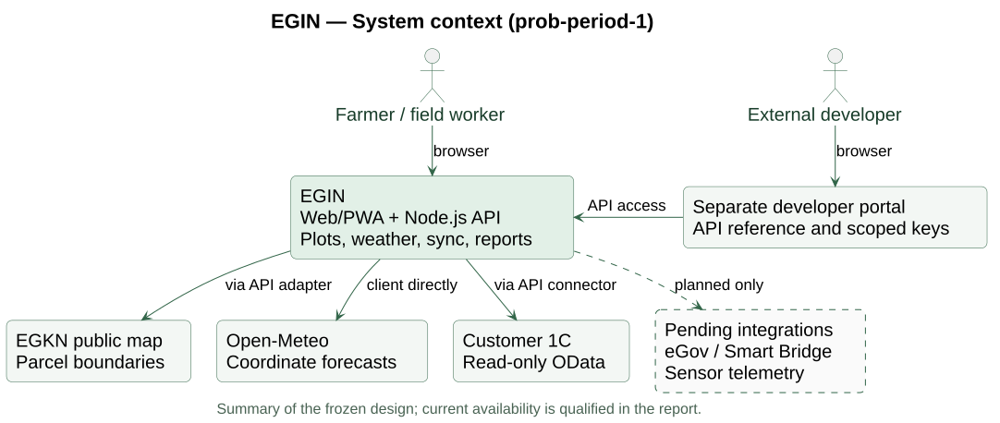
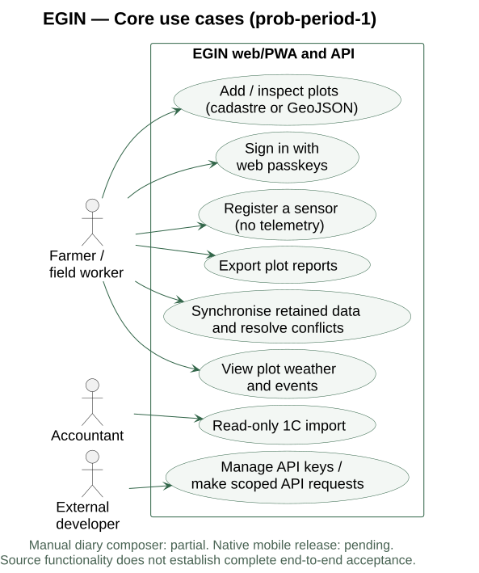
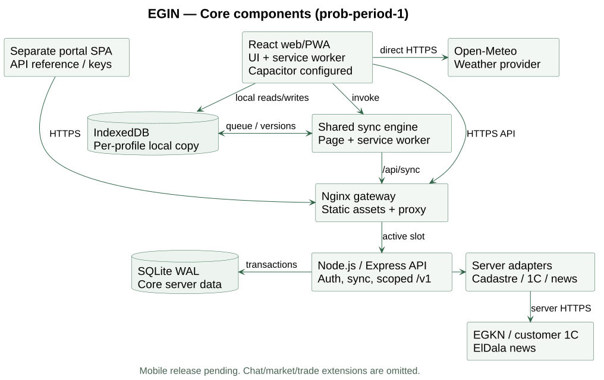

# 7. Architecture and Diagrams

EGIN uses a local-first client–server architecture. The React application keeps the user's working data in IndexedDB; the Node.js API provides identity, synchronisation and integration services. SQLite stores core account and plot data. A separate developer portal exposes documented, scoped access. Additional chat/trade modules are outside this core diagram set.

## 7.1 System context

The farmer works with plots, weather and local records. The cadastral adapter obtains public parcel data; 1C supplies read-only accounting imports. Weather is requested directly by the client. External developers use the documented API. eGov and live sensor telemetry remain pending integrations.

*Summary diagram. The complete system context and integration contracts remain in the [detailed architecture](../../PART-7-ARCHITECTURE.md).*

<!-- pagebreak -->

## 7.2 Core use cases

The diagram groups the main user goals. Plot acquisition and forecast viewing are the principal walkthrough. Authentication controls server access; local guest data is separate from authenticated synchronisation. The current event centre can display retained history, but the legacy manual diary composer is not exposed in the active UI.

| User goal | Requirement trace |
|---|---|
| Sign in, recover access and synchronise | FR-AUTH-1–4; FR-SYNC-2–8 |
| Acquire a plot and view its forecast | FR-FLD-1–7; FR-WTH-1–3 |
| Review events, register a sensor and export | FR-EVT-1; FR-SNS-1–2; FR-RPT-1 |
| Import 1C records or integrate through the API | FR-INT-1–2; FR-API-1–3 |

<!-- pagebreak -->

## 7.3 Components and data flow

The client and service worker share one synchronisation engine. Changes use monotonic sequence cursors, record versions, deletion tombstones and explicit conflict resolution. This is designed to preserve concurrent work; successful end-to-end acceptance remains a separate check.

The Nginx gateway serves both web applications and routes API traffic to the active deployment slot. Main-app and portal sessions remain separate. Capacitor configuration shares the web codebase, while native release validation is pending. Provider adapters apply bounded requests and privacy filtering. The [full component, deployment and sequence diagrams](../../diagrams/) retain implementation-level detail and editable PlantUML sources.
