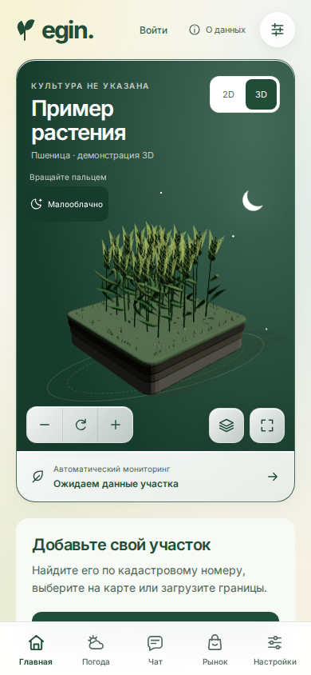
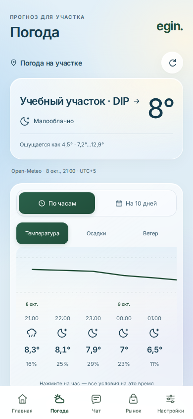

# 8. UX and Prototype

The [web prototype](https://egin.perricheno.com) uses a phone-first layout with Home, Weather, Chat, Market and Settings tabs. Plots, events, reports and the sensor registry are reached from Home or Settings. The interface is Russian; report descriptions are English. The crop illustration is an interface example, not a measured digital twin.

<figure><figcaption>Home: crop illustration and plot onboarding.</figcaption></figure>
<figure><figcaption>Weather: the selected plot and fixture forecast.</figcaption></figure>

The core demonstration is: **open Home → add or import a plot → confirm its boundary → inspect the forecast → review events → export available data**. A separate authenticated exercise must check offline changes, reconnection and conflict resolution. The [developer portal](https://api-egin.perricheno.com) provides API examples and scoped-key management.

These images come from fresh web builds of `b0b0f46`, whose application tree equals the tagged version. Nine captures completed on 23 October 2026 with zero page errors. Synthetic guest records and intercepted APIs were used; the forecast is a historical fixture. These captures do not establish live provider access, authentication, offline reload, export download or user acceptance. [All screenshots, source fingerprints and reproduction instructions](../../evidence/ux/) are available separately.
